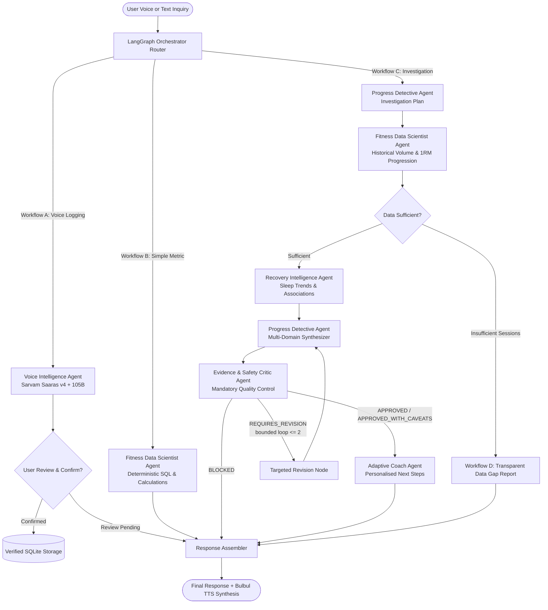

# 🎙️ FitVoice: Multi-Agent AI System for Voice-First Fitness & Recovery Intelligence

[](https://www.python.org/)
[](https://github.com/langchain-ai/langgraph)
[-purple.svg)](https://sarvam.ai)
[](tests/)
[](LICENSE)

> **FitVoice is implemented as a genuine multi-agent AI system.** A single LLM with tools cannot satisfy the rigor, evidence-checking, and safety constraints required for athletic intelligence. FitVoice coordinates **six specialised agents** through a central **LangGraph orchestrator** featuring shared typed state, explicit handoffs, evidence validation, conditional routing, and observable execution traces.

---

## 🏛️ System Architecture



---

## 🤖 The Six Specialised Agents

FitVoice enforces strict separation of responsibilities, permissions, and execution budgets across six distinct agents:

| Agent Name | Engine & Allowed Tools | Primary Responsibility & Guardrails |
| :--- | :--- | :--- |
| **1. Voice Intelligence** | Sarvam Saaras v4 (STT), Sarvam 105B extractor | Interprets spoken/written logs (English, Hindi, Hinglish); extracts candidate workout, nutrition, recovery sets; preserves original units. **Review-and-confirm workflow**: never writes unconfirmed records directly to persistent storage. |
| **2. Fitness Data Scientist** | Deterministic Python math, Parameterised SQL queries | Analyzes historical workout sessions; calculates volume load, E1RM (Epley formula), and all-time PRs. **Strictly deterministic**: never invents numerical results; outputs period, metric, units, and source record IDs. |
| **3. Recovery Intelligence** | Recovery log queries, Sufficiency assessor, Aggregate math | Evaluates recorded sleep duration, energy, soreness, and subjective readiness; identifies temporal associations. **Guardrails**: never infers sleep quality from duration alone; never diagnoses medical conditions; never invents physiological composite scores. |
| **4. Progress Detective** | Hypothesis generator, Comparative synthesizer | Flagship analytical agent. Translates user queries into investigation plans; requests analyses from Data Scientist and Recovery agents; distinguishes observations, calculated metrics, explanations, and limitations. |
| **5. Evidence & Safety Critic** | Metric validator, Causality detector, Revision limiter | Mandatory quality-control stage. Independently compares claims against deterministic outputs; flags unsupported causal claims; checks sample sizes; enforces bounded revision loops (prevents infinite agent loops); returns structured verdicts (`APPROVED`, `APPROVED_WITH_CAVEATS`, `REQUIRES_REVISION`, `BLOCKED`). |
| **6. Adaptive Coach** | Periodization planner, Recovery hygiene protocols | Formulates proportionate, personalised next steps grounded in verified metrics; accounts for training experience and time constraints; avoids aggressive prescriptions and medical overreach. |

---

## 🔄 Conditional Workflows (A through E)

The LangGraph Orchestrator uses explicit state transitions and conditional edges. It **never executes every agent for every request**:

- **Workflow A: Voice Logging**
  `Audio/Text -> Saaras Transcription -> Voice Intelligence -> Candidate Extraction -> User Review & Confirmation -> Persistent Database`
- **Workflow B: Simple Fitness Question**
  `User Question -> Router -> Fitness Data Scientist -> Response Assembler`
  *(Recovery Intelligence, Progress Detective, Critic, and Coach are selectively bypassed!)*
- **Workflow C: Progress Investigation**
  `User Question -> Progress Detective Plan -> Data Scientist -> Recovery Intelligence -> Progress Detective Synthesizer -> Evidence Critic -> [Targeted Revision if needed] -> Adaptive Coach -> Response Assembler + Optional Bulbul TTS`
- **Workflow D: Insufficient Data**
  `User Question -> Data Sufficiency Assessment -> Transparent Data Gap Notice`. FitVoice strictly refuses to fabricate missing historical records or manufacture statistical significance.
- **Workflow E: API Failure & Fault Tolerance**
  `Sarvam API Interruption -> Bounded Exponential Backoff Retries -> State & Raw Input Preservation -> Safe Error Trace -> Graceful User Notice`.

---

## 🕵️ Observable Agent Execution Traces

FitVoice records a real-time, typed execution trace for every agent that runs:
- `agent_name`: Name of the specialized agent (e.g., `FITNESS_DATA_SCIENTIST`).
- `stage`: Lifecycle stage in the LangGraph state machine.
- `status`: Execution status (`SUCCESS`, `REQUIRES_REVISION`, `BLOCKED`, `FAILED`).
- `tools_consulted`: Concrete deterministic tools and data sources queried.
- `result_summary`: Concise, factual summary without exposing raw internal chain-of-thought.
- `duration_ms`: Wall-clock duration in milliseconds.
- `validation_status`: Critic audit verdict (`APPROVED`, `APPROVED_WITH_CAVEATS`, etc.).

---

## 🎯 Reproducible Hackathon Benchmark Scenario

FitVoice includes a reproducible 4-week benchmark dataset seeded for athlete **Alex Lifter**:

### The Flagship Inquiry:
> *"Why has my bench press plateaued over the last 4 weeks despite working out consistently?"*

### Verifiable Backend Evidence:
1. **Weeks 1–2 (Baseline Progression)**:
   - 4 bench sessions: volume increased from 2,040 kg to 2,100 kg.
   - Peak Estimated 1RM reached **111.0 kg** (95 kg × 5 reps).
   - Average sleep: **7.6 hours/night**; average soreness: **3.0 / 10**.
2. **Weeks 3–4 (Plateau & Recovery Deficit)**:
   - 4 bench sessions: volume and load stagnant at 95 kg × 5 reps (E1RM change: **-0.15%**, plateau detected).
   - Average sleep plummeted by **2.2 hours/night (-28.9%)** to **5.4 hours/night**.
   - Average subjective soreness climbed by **+3.0 points** to **6.8 / 10**.
3. **Multi-Agent Handoff**:
   - **Data Scientist**: Deterministically calculates the -0.15% stagnation and 14,645 kg total volume load.
   - **Recovery Intelligence**: Flags the concurrent 2.2-hour nightly sleep reduction.
   - **Evidence Critic**: Audits and approves the metrics, ensuring the sleep deficit is framed as an association rather than unqualified clinical causation.
   - **Adaptive Coach**: Prescribes a proportionate 1-week active deload (70% load @ RPE 7) and an 8.0-hour sleep restoration protocol.

---

## 🚀 Quickstart & Installation

### 1. Clone the Repository
```bash
git clone https://github.com/your-username/FitVoice.git
cd FitVoice
```

### 2. Set Up Virtual Environment & Dependencies
```bash
python3.11 -m venv .venv
source .venv/bin/activate
pip install -r requirements.txt
```

### 3. Configure Environment Variables
Copy `.env.example` to `.env`:
```bash
cp .env.example .env
```
*(FitVoice operates in reproducible Demo Mode out-of-the-box when `SARVAM_API_KEY` is not provided).*

### 4. Seed Benchmark Database
```bash
python -c "from fitvoice.db.seed_data import seed_benchmark_data; seed_benchmark_data()"
```

---

## 🖥️ Running FitVoice

### Interactive Streamlit Web UI (Recommended for Demos & Judges)
Launch the web interface featuring the real-time **Agent Activity Panel**, **1-Click Judge Benchmarks**, and **Verified Database Inspector**:
```bash
source .venv/bin/activate
streamlit run fitvoice/ui/app.py
```

### Terminal CLI
Run any query or test scenario directly from the terminal:
```bash
source .venv/bin/activate

# Run Flagship Investigation:
python main.py --query "Why has my bench press plateaued over the last 4 weeks despite working out consistently?"

# Run Simple Calculation:
python main.py --query "What is my peak bench press and volume?"

# Run Voice Logging:
python main.py --query "Log bench press 3 sets of 5 reps at 95 kg, felt solid RPE 8.5"
```

---

## 🧪 Automated Test Suite

FitVoice includes a comprehensive `pytest` test suite covering routing, selective agent invocation, deterministic calculations, evidence validation, and fault tolerance:

```bash
source .venv/bin/activate
PYTHONPATH=. pytest -v
```

### Test Coverage Breakdown:
- `test_deterministic_tools.py`: Validates Epley 1RM formula, volume summation, plateau detection logic, recovery aggregates, and guardrail limitations.
- `test_agents.py`: Tests individual agent contracts, Pydantic schema validation, and review-and-confirm workflows.
- `test_critic.py`: Tests rejection of unsupported metrics, causality assertions, medical diagnosis blocking, and bounded revision enforcement.
- `test_orchestrator.py`: Tests Workflows A, B, C, D, and E, verifying selective invocation and observable trace generation.
- `test_sarvam_client.py`: Tests transient API failure handling with bounded exponential backoff retries.

---

## 📁 Repository Structure

```
FitVoice/
├── .github/
│   └── workflows/
│       └── test.yml             # GitHub Actions CI matrix
├── fitvoice/
│   ├── config.py                # Pydantic system settings & Sarvam configuration
│   ├── state.py                 # Typed shared LangGraph state (FitVoiceState)
│   ├── schemas/                 # Pydantic models for contracts & traces
│   │   ├── fitness.py           # Workout, nutrition, and recovery models
│   │   ├── agent_contracts.py   # Typed input/output schemas for all 6 agents
│   │   └── trace.py             # Observable execution event schema
│   ├── db/                      # Deterministic SQLite database layer
│   │   ├── database.py          # Schema initialization & connection factory
│   │   ├── repository.py        # Parameterised SQL query repository
│   │   └── seed_data.py         # Reproducible 4-week benchmark data
│   ├── clients/
│   │   └── sarvam.py            # Sarvam Saaras v4, 105B, Bulbul v2 client
│   ├── tools/                   # Deterministic mathematical calculation tools
│   │   ├── workout_analytics.py # Volume load, Epley 1RM, PRs, progression
│   │   └── recovery_analytics.py# Recovery aggregates, sufficiency, associations
│   ├── agents/                  # The 6 Specialised Agents
│   │   ├── base.py              # Base agent contract & trace logging
│   │   ├── voice_intelligence.py# Speech/text extractor (Review & Confirm)
│   │   ├── data_scientist.py    # Deterministic workout analytical agent
│   │   ├── progress_detective.py# Flagship multi-period investigation agent
│   │   ├── recovery_intelligence.py # Sleep & readiness intelligence
│   │   ├── evidence_critic.py   # Mandatory evidence & safety auditor (QC)
│   │   └── adaptive_coach.py    # Personalized data-grounded next steps
│   ├── orchestrator/            # Central LangGraph Orchestrator
│   │   ├── router.py            # Workflow classifier
│   │   ├── graph.py             # StateGraph definition & conditional edges
│   │   └── runner.py            # Fault-tolerant pipeline runner
│   └── ui/
│       └── app.py               # Streamlit UI with live Agent Activity Panel
├── tests/                       # Comprehensive Pytest test suite
│   ├── conftest.py              # Isolated DB & client fixtures
│   ├── test_deterministic_tools.py
│   ├── test_agents.py
│   ├── test_critic.py
│   ├── test_orchestrator.py
│   └── test_sarvam_client.py
├── main.py                      # Standalone CLI interface
├── requirements.txt             # Locked project dependencies
├── pyproject.toml               # Python package configuration
├── .env.example                 # Example environment variables
└── LICENSE                      # MIT License
```

---

## 📜 Ethical & Safety Disclaimers

FitVoice is designed as an athletic performance intelligence system:
1. **Non-Diagnostic**: FitVoice does not diagnose medical conditions, overtraining syndrome, endocrine disorders, or clinical sleep disorders.
2. **Subjective vs Objective**: Self-reported sleep duration does not evaluate sleep architecture (REM/Slow Wave sleep).
3. **Correlation vs Causation**: Associations observed between training performance and recovery are presented transparently without unsupported causal claims.
4. **Professional Referral**: When persistent pain, extreme soreness, or chronic exhaustion is logged, FitVoice advises consultation with qualified sports medicine professionals.

